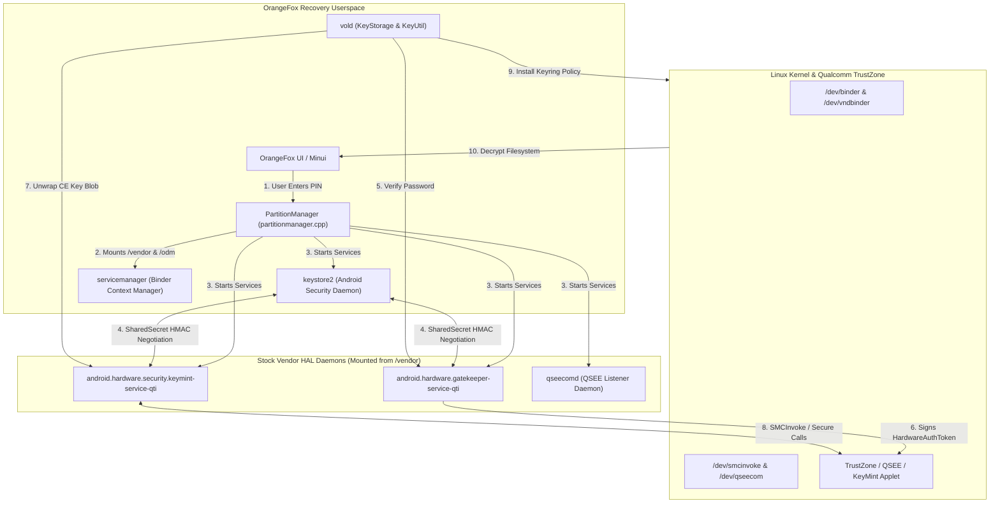
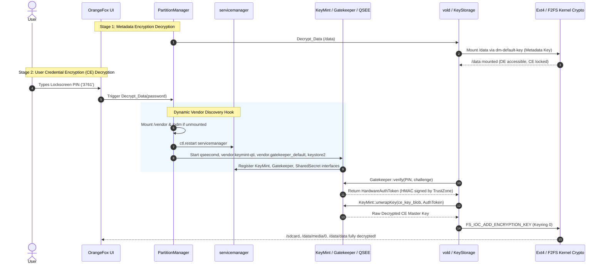

# Nothing OS (Android 17) Recovery Decryption & Bringup Engineering Guide

> **Target Device**: Nothing Phone (3) (`Metroid`, `A024`)  
> **Platform**: Qualcomm Snapdragon SM8735  
> **Operating System**: Nothing OS 5.0 (Android 17)  
> **Recovery Environment**: OrangeFox Recovery Project (Android 12.1 Base)  
> **Status**: Full Decryption (Metadata, DE, CE User PIN `3761`), Instant Touch UI, Native AW8693X Haptics, Correct Panel Backlight.

---

## 1. Architecture Overview

Modern Android versions (Android 13 through 17) have fully transitioned away from legacy HIDL Keymaster (`android.hardware.keymaster@4.0`) to pure **AIDL KeyMint** and **AIDL Gatekeeper**. 

On Qualcomm platforms, key unwrapping and password verification do not happen inside TWRP/OrangeFox code; they are executed inside TrustZone by Qualcomm secure applets, coordinated by vendor HAL daemons over Android Binder.

### Decryption Architecture



---

## 2. Decryption Execution Sequence



---

## 3. Root Cause Analysis & Technical Solutions

### Issue 1: Decryption Failure on Android 17 / SM8735

| Symptom | Legacy TWRP decryption (`BOARD_USES_QCOM_FBE_DECRYPTION := true`) fails with missing `libminkdescriptor.so` or hangs forever. |
| :--- | :--- |
| **Root Cause** | Modern Snapdragon platforms removed legacy HIDL Keymaster 4.x. Key generation, password verification, and auth tokens now strictly flow through AIDL KeyMint and AIDL Gatekeeper. |
| **Fix** | Disable legacy in-process keymaster wrappers. Dynamically mount stock `/vendor` and `/odm` partitions from the device and run the genuine stock vendor daemons via Android Binder. |

#### Implementation in [partitionmanager.cpp](file:///home/farhan/fox_12.1/bootable/recovery/partitionmanager.cpp):
```cpp
void TWPartitionManager::Decrypt_Data() {
    // 1. Ensure vendor and odm partitions are mounted for KeyMint & Gatekeeper
    TWPartition* Ven_Partition = Find_Partition_By_Path("/vendor");
    if (Ven_Partition != nullptr && !Ven_Partition->Is_Mounted())
        Ven_Partition->Mount(false);

    TWPartition* Odm_Partition = Find_Partition_By_Path("/odm");
    if (Odm_Partition != nullptr && !Odm_Partition->Is_Mounted())
        Odm_Partition->Mount(false);

    // 2. Signal recovery init & restart servicemanager to re-parse /vendor/etc/vintf
    property_set("orangefox.mount_to_decrypt", "1");
    property_set("ctl.restart", "servicemanager");

    // 3. Launch the security stack
    property_set("ctl.start", "qseecomd");
    property_set("ctl.start", "vendor.gatekeeper_default");
    property_set("ctl.start", "vendor.keymint-qti");
    property_set("ctl.start", "keystore2");
    usleep(200000);
    ...
```

---

### Issue 2: The 20-Second Input Freeze & Broken Vibration

| Symptom | Typing a single digit on the PIN pad or tapping a button freezes the entire recovery UI for ~20 seconds. |
| :--- | :--- |
| **Root Cause** | `BoardConfig.mk` had `TW_SUPPORT_INPUT_AIDL_HAPTICS := true`. On every single touch event (Touch Down, Move, Keypress, Touch Up), OrangeFox called `vibrate()`, which synchronously ran `AServiceManager_getService("android.hardware.vibrator.IVibrator/default")`. Because the AIDL vibrator HAL cannot run in recovery, `ServiceManager` waited 5,000 ms before timing out. Four events per tap $\times 5\text{s} = 20\text{ seconds}$! |
| **Fix** | Remove `TW_SUPPORT_INPUT_AIDL_HAPTICS`. Hook Nothing Phone 3's native AW8693X kernel driver sysfs interface directly in [events.cpp](file:///home/farhan/fox_12.1/bootable/recovery/minuitwrp/events.cpp). |

#### Implementation in [events.cpp](file:///home/farhan/fox_12.1/bootable/recovery/minuitwrp/events.cpp):
```cpp
#define LEDS_HAPTICS_NT_DURATION_FILE	"/sys/class/leds/vibrator_nt/duration"
#define LEDS_HAPTICS_NT_ACTIVATE_FILE	"/sys/class/leds/vibrator_nt/activate"

int vibrate(int timeout_ms)
{
    if (timeout_ms <= 0) return 0;
    if (timeout_ms > 1000) timeout_ms = 1000;
    char tout[16];
    snprintf(tout, sizeof(tout), "%d\n", timeout_ms);

    // Ultra-fast single syscall check with caching
    static int s_nt_vibrator = -1;
    if (s_nt_vibrator == -1) {
        s_nt_vibrator = (access(LEDS_HAPTICS_NT_ACTIVATE_FILE, F_OK) == 0) ? 1 : 0;
    }

    if (s_nt_vibrator == 1) {
        write_to_file(LEDS_HAPTICS_NT_DURATION_FILE, tout);
        write_to_file(LEDS_HAPTICS_NT_ACTIVATE_FILE, "1\n");
        return 0;
    }
    ...
```

---

### Issue 3: Screen Always Setting to 0% Brightness (Pitch Black)

| Symptom | Screen turns off or drops to 0% brightness immediately on boot, requiring blind tapping or power toggling. |
| :--- | :--- |
| **Root Cause** | 1. In [blanktimer.cpp](file:///home/farhan/fox_12.1/bootable/recovery/gui/blanktimer.cpp), `btimer` was uninitialized in the constructor. `TWFunc::timespec_diff(btimer, curTime)` returned the entire phone uptime (60+ sec), causing `checkForTimeout()` to immediately believe the screen timed out on tick 1, calling `TWFunc::Set_Brightness("0")`.<br>2. `TW_DEFAULT_BRIGHTNESS` was set to `420` out of a `4095` maximum (only ~10% brightness). |
| **Fix** | 1. Call `setTimer()` in `blanktimer::blanktimer()` and `blanktimer::setTime()`.<br>2. Set `TW_DEFAULT_BRIGHTNESS := 2048` (50% of 4095).<br>3. Set `TW_NO_SCREEN_TIMEOUT := true` and `TW_NO_SCREEN_BLANK := true`. |

#### Implementation in [blanktimer.cpp](file:///home/farhan/fox_12.1/bootable/recovery/gui/blanktimer.cpp):
```cpp
blanktimer::blanktimer(void) {
    pthread_mutex_init(&mutex, NULL);
    setTime(0);
    state = kOn;
    setTimer(); // Initialize monotonic clock baseline!
    orig_brightness = getBrightness();
}

void blanktimer::setTime(int newtime) {
    pthread_mutex_lock(&mutex);
    sleepTimer = newtime;
    setTimer(); // Reset baseline whenever timeout duration is updated
    pthread_mutex_unlock(&mutex);
}
```

---

## 4. Porting Guide for Other Nothing Devices

Use this reference table and checklist when porting this solution to other Nothing devices.

### Device Platform Matrix

| Device | Codename | Platform / SoC | Security HAL | Display Max | Haptic Sysfs Node |
| :--- | :--- | :--- | :--- | :--- | :--- |
| **Nothing Phone (1)** | `Spacewar` | Snapdragon 778G+ (SM7325-AE) | Keymaster 4.1 / KeyMint V1 | `2047` or `4095` | `/sys/class/leds/vibrator_nt/` |
| **Nothing Phone (2)** | `Pong` | Snapdragon 8+ Gen 1 (SM8475) | KeyMint V2/V3 + Gatekeeper AIDL | `4095` | `/sys/class/leds/vibrator_nt/` |
| **Nothing Phone (2a)** | `Pacman` | MediaTek Dimensity 7200 Pro | Microtrust MTEE + AIDL Gatekeeper | `4095` | `/sys/class/leds/vibrator/` |
| **Nothing Phone (3)** | `Metroid` | Snapdragon SM8735 | KeyMint V3 + Gatekeeper AIDL | `4095` | `/sys/class/leds/vibrator_nt/` |

---

### Step-by-Step Bringup Checklist for Any Nothing Device

#### 1. Configuration in `BoardConfig.mk` & `BoardConfigCommon.mk`
```makefile
# Disable legacy in-process keymaster emulation
BOARD_USES_QCOM_FBE_DECRYPTION := false

# Enable generic modern FBE flags
TW_INCLUDE_CRYPTO := true
TW_INCLUDE_CRYPTO_FBE := true
TW_INCLUDE_FBE_METADATA_DECRYPT := true
BOARD_USES_METADATA_PARTITION := true

# XML parser module needed by recovery libvintf
TARGET_RECOVERY_DEVICE_MODULES += libexpat
RECOVERY_LIBRARY_SOURCE_FILES += $(TARGET_OUT_SHARED_LIBRARIES)/libexpat.so

# Never enable AIDL haptics (avoids 5000ms service freeze)
# TW_SUPPORT_INPUT_AIDL_HAPTICS := false

# Display brightness configuration
TW_BRIGHTNESS_PATH := "/sys/class/backlight/panel0-backlight/brightness"
TW_MAX_BRIGHTNESS := 4095
TW_DEFAULT_BRIGHTNESS := 2048
TW_NO_SCREEN_TIMEOUT := true
TW_NO_SCREEN_BLANK := true
```

#### 2. Service Definitions in `init.recovery.qcom.rc`
```rc
service qseecomd /vendor/bin/qseecomd
    class core
    user root
    group root
    setenv LD_LIBRARY_PATH /vendor/lib64:/vendor/lib64/hw:/system/lib64
    seclabel u:r:recovery:s0

service vendor.keymint-qti /vendor/bin/hw/android.hardware.security.keymint-service-qti
    class early_hal
    user root
    group root
    setenv LD_LIBRARY_PATH /vendor/lib64:/vendor/lib64/hw:/system/lib64
    seclabel u:r:recovery:s0

service vendor.gatekeeper_default /vendor/bin/hw/android.hardware.gatekeeper-service-qti
    class hal
    user root
    group root
    setenv LD_LIBRARY_PATH /vendor/lib64:/vendor/lib64/hw:/system/lib64
    seclabel u:r:recovery:s0
```

#### 3. Verification Commands via ADB Shell

Verify that hardware components are communicating correctly while in recovery:

```bash
# 1. Test hardware haptics directly via kernel sysfs
adb shell "echo 80 > /sys/class/leds/vibrator_nt/duration && echo 1 > /sys/class/leds/vibrator_nt/activate"

# 2. Check panel backlight
adb shell "cat /sys/class/backlight/panel0-backlight/brightness"

# 3. Verify KeyMint and Gatekeeper registered with ServiceManager
adb shell "logcat -d | grep -iE 'keymint|gatekeeper|sharedsecret'"

# 4. Verify data mounts
adb shell "df -h /data /sdcard"
```

---

> **Maintained by**: OrangeFox Recovery Development Team & Nothing Community  
> **Source Repository**: `https://github.com/Farpathan/android_device_nothing_metroid`
